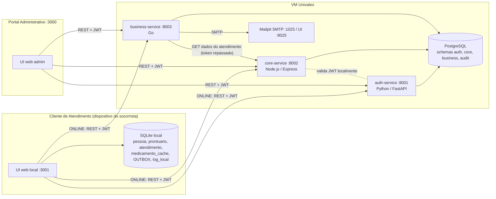

# MedicalField – Arquitetura (versão definitiva)

## 1. Visão geral



*Modo OFFLINE:* o cliente **não** chama nenhum serviço; lê e grava só no SQLite e enfileira
cada operação na tabela `outbox`. Ao voltar para ONLINE, o `ConnectivityMonitor` (Observer)
notifica o `SyncManager`, que faz **push** da outbox e depois **pull** dos dados novos.

## 2. Tecnologias e justificativas

| Componente | Tecnologia | Por quê |
|---|---|---|
| auth-service | **Python 3.12 + FastAPI** | Swagger automático, bcrypt/JWT maduros, código curto |
| core-service | **Node.js 22 + Express** | CRUD simples e rápido; mesma linguagem do cliente |
| business-service | **Go 1.22** | 3ª linguagem; binário único (fácil na VM); PDF (`go-pdf/fpdf`) e SMTP na stdlib |
| Banco central | **PostgreSQL 16** | Exigido; um banco, um *schema* por responsabilidade |
| Banco local | **SQLite** (`better-sqlite3`) | Exigido; arquivo único embarcado no cliente |
| Cliente / Portal | **Node + HTML/JS puro** servidos localmente | Sem build, sem framework; roda com um comando |
| E-mail (testes) | **Mailpit** | SMTP de testes gratuito com UI web para mostrar o anexo |
| Process manager (VM) | **systemd** | Já existe na VM; reinício automático após reboot |

Decisões de simplificação: um único PostgreSQL com *schemas* (em vez de 3 instâncias);
JWT HS256 com segredo compartilhado (validação local, sem chamada ao auth a cada request);
sem API Gateway (cada serviço expõe a própria porta); sem Docker.

## 3. Responsabilidades

| Serviço | Responsável por | Endpoints (PDF do professor) |
|---|---|---|
| auth | Login, JWT, identificação do profissional | `POST /auth/login` |
| core | Pessoa, prontuário, atendimento, **sincronização**, recepção de logs offline | `GET/POST /pessoa`, `GET/POST /prontuario`, `GET /prontuario/{id}`, `POST /atendimento`, `GET /atendimento/{id}`, `POST /log` + `POST /sync/push`, `GET /sync/pull` |
| business | Medicamentos, PDF da ficha, e-mail | `GET /medicamento` + `GET /ficha/{id}/pdf`, `POST /ficha/{id}/email` |

> `{id}` em `/prontuario/{id}` e `/atendimento/{id}` = **id da pessoa**, como no enunciado.

## 4. Modelo PostgreSQL (database/migrations)

```
auth.profissional(id PK, tipo_registro, identificacao UNIQUE, nome, email, perfil, senha_hash, ativo, ultimo_login)

core.pessoa(id PK uuid, nome, cpf UNIQUE, data_nascimento, sexo, telefone, email, contato_emergencia,
            criado_por, origem, client_created_at, client_updated_at, version, created_at, updated_at)
core.prontuario(id PK, pessoa_id FK UNIQUE -> pessoa, tipo_sanguineo, alergias, condicoes_cronicas, ...)
core.atendimento(id PK, prontuario_id FK, pessoa_id FK, profissional_id, data_hora, queixa_principal,
            sinais vitais (PA, FC, FR, SpO2, temp, glicemia), glasgow_ocular/verbal/motor + glasgow_total (gerado),
            triagem_manchester, triagem_start, conduta, encaminhamento, origem, ...)
core.atendimento_medicamento(id PK, atendimento_id FK, medicamento_id, nome, dose, via, horario)
core.id_alias(local_id PK, entidade, canonical_id)            -- duplicatas fundidas na sincronização
core.sync_operation(op_id PK, entidade, operacao, registro_id, profissional_id, resultado, detalhe jsonb)

business.medicamento(id PK, nome, principio_ativo, apresentacao, via_administracao, dose_max_unitaria, ..., updated_at)
business.email_enviado(id PK, atendimento_id, destinatario, enviado_por, sucesso, erro)

audit.access_log(id PK, servico, ocorrido_em, ip_cliente, profissional_id, metodo, rota, status_code, tempo_ms, origem, detalhe)
```

Regras-chave: **PK UUID gerada no cliente** (idempotência); **sem FK entre schemas** (serviços
independentes; `profissional_id` e `medicamento_id` são referências lógicas); FKs *dentro* do `core`
garantem a integridade pessoa → prontuário → atendimento.

## 5. Modelo SQLite (cliente) – a ser criado na Etapa 5

`pessoa`, `prontuario`, `atendimento`, `atendimento_medicamento` (mesmas colunas do servidor, mais
`sync_status` = `PENDING | SYNCED | CONFLICT | ERROR` e `synced_at`); `medicamento_cache`;
`outbox(op_id, entidade, operacao, registro_id, payload, profissional_id, created_at, status, tentativas, ultimo_erro)`;
`sync_state(chave, valor)` (cursor do pull); `log_local` (acessos feitos offline, enviados via `POST /log`).

Registros locais × oficiais: o que está `PENDING` só existe no SQLite; só vira `SYNCED` após o
servidor responder que persistiu.

## 6. Sincronização (resumo)

1. **Push**: envia a outbox em ordem (pessoa → prontuário → atendimento) em `POST /sync/push`; cada operação tem `op_id`.
2. Servidor, por operação e em transação: já viu o `op_id`? → `DUPLICATE` (idempotente). Mesmo `id`? → compara
   `client_updated_at` (Strategy). Mesmo CPF com `id` diferente? → `MERGED` + `id_alias`.
3. Resposta por operação → cliente marca `SYNCED` **somente** nas confirmadas; falhas ficam na fila com retentativa (backoff).
4. **Pull**: `GET /sync/pull?since=` (core) + `GET /medicamento?since=` (business) atualizam o SQLite.
5. `POST /log` envia o `log_local` ao core (grava em `audit.access_log` com `origem='OFFLINE'`).

## 7. Padrões de projeto

| # | Padrão | Onde | Problema que resolve |
|---|---|---|---|
| 1 | Repository | Cliente (`Local*Repository`/`Remote*Repository`) e serviços (`ProfissionalRepository`…) | UI/regras não conhecem SQL nem HTTP |
| 2 | Strategy | `ConflictResolver` (LastWriteWins, ServerWins, FieldMerge) | Troca o algoritmo de resolução sem mexer no sync |
| 3 | Observer | `ConnectivityMonitor` → `SyncManager`/UI | Dispara a sincronização ao voltar ONLINE |
| 4 | Chain of Responsibility | Middlewares: CORS → log de acesso → JWT → handler | Cada preocupação transversal em um elo |
| 5 | Factory | `RepositoryFactory` (escolhe Local/Remote conforme o modo) e `ConflictStrategyFactory` | Centraliza a criação e o if ONLINE/OFFLINE |
| 6 | Facade | `SyncService` (push + pull + logs) | A UI chama um método; a complexidade fica escondida |
| 7 | Singleton | Pool de conexões (`db.py`, `pg.Pool`, `sql.DB`) | Uma instância de conexão por processo |
| + | Outbox *(padrão de integração)* | Tabela `outbox` | Garante entrega *at-least-once* + idempotência |

Já implementados: Repository, Singleton e Chain of Responsibility (auth e core); Strategy e Factory (`core/src/sync/conflictStrategies.js`); Adapter (`business/mailer.go` isola o SMTP). Faltam no cliente: Observer, Facade e Repository local/remoto.

## 8. Cobertura dos requisitos do PDF do professor

| Requisito | Situação |
|---|---|
| 3 serviços em linguagens distintas | Python ✅ + Node.js ✅ + Go ✅ |
| Persistência dual (central + local) | PostgreSQL ✅ · SQLite (Etapa 5) |
| Rotas autenticadas, exceto login | ✅ auth e core (`/docs` é a única exceção, desligável com `ENABLE_DOCS=false`) |
| Logs: data/hora, IP, profissional, método, rota, status, ms | ✅ auth e core (arquivo + `audit.access_log`) |
| Glasgow, Manchester, START, medicamentos administrados | ✅ modelados em `core.atendimento` |
| Receber dados do Portal (pull) e medicamentos inseridos via SQL | ✅ `updated_at` + trigger em `business.medicamento` |
| `POST /log` (logs offline) | ✅ core (idempotente) |
| PDF e e-mail com anexo | ✅ business (Go) + Mailpit |
| GUIs, simulador ONLINE/OFFLINE, Swagger unificado, deploy | Etapas 4 a 7 |
