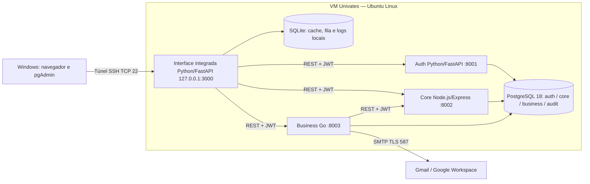
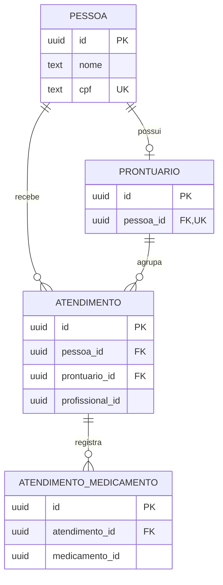

# MedicalField — Arquitetura da versão final acadêmica

Universidade do Vale do Taquari — Arquiteturas de Software, 2026/B.

## Arquitetura implantada

A interface integrada reúne Atendimento, Administração (perfil ADMIN) e Medicamentos. O navegador usa uma única porta; as três APIs independentes permanecem acessíveis via túnel para a demonstração Swagger. O PostgreSQL é único, separado em schemas; não há bancos fisicamente independentes por serviço. A instância implantada mantém o SQLite no mesmo servidor da GUI, em arquivo separado do PostgreSQL. OFFLINE é o simulador de rede da interface, não perda física da conexão do Windows com a VM. Se o túnel cair, a GUI hospedada na VM não fica acessível no navegador. Para offline físico seria necessário executar o cliente no dispositivo (não adotado na configuração aprovada).

| Componente | Tecnologia / ambiente |
|---|---|
| Auth | Python 3.14 / FastAPI / bcrypt / JWT HS256 |
| Core | Node.js 22 / Express / pg / Zod (migração para 4.6.7) |
| Business | Go 1.26 / net/http / lib/pq / go-pdf/fpdf / SMTP |
| Interface | Python/FastAPI + HTML/CSS/JavaScript; porta 3000 |
| Central | PostgreSQL 18 |
| Cache e fila | SQLite via módulo sqlite3 da biblioteca padrão Python |
| Implantação | Ubuntu 26.04 LTS x86_64, systemd, SSH; sem Docker |

## Comunicação e responsabilidades

- Auth autentica por identificação profissional e senha; retorna perfil e JWT. Os consumidores validam HS256 com segredo compartilhado e issuer `medicalfield-auth`.
- Core mantém pessoas, prontuários, atendimentos, sincronização e logs offline; consultas REST autenticadas. As operações administrativas da GUI exigem perfil ADMIN. Nas APIs Core originais os PUT aceitam qualquer profissional autenticado; DELETE exige ADMIN.
- Business lista e cadastra medicamentos, consulta a ficha no Core e gera PDF; envia anexo via SMTP com senha de aplicativo do Google configurada no `.env`.
- A GUI faz proxy das chamadas e verifica o JWT. Em OFFLINE as rotas de registros usam SQLite; login requer serviço central e token válido. As documentações Swagger e o login são exceções públicas à autenticação, mas ficam atrás do túnel SSH na implantação restrita.

## Modelagem dos bancos

Fonte de verdade: `database/migrations/*.sql` e `applications/attendance-client/server.py::init_db`. O modelo relacional simplificado a seguir representa as chaves e relacionamentos efetivos.

PostgreSQL:

| Schema e tabela | Campos principais e função |
|---|---|
| auth.profissional | id UUID PK; tipo_registro, identificacao UNIQUE, nome, email, perfil, senha_hash, ativo, ultimo_login |
| core.pessoa | id UUID PK, nome, cpf UNIQUE, data_nascimento, sexo, telefone, email, contato_emergencia, criado_por, origem, client_created_at, client_updated_at, version, created_at, updated_at |
| core.prontuario | id UUID PK, pessoa_id FK UNIQUE, tipo_sanguineo, alergias, condicoes_cronicas, medicamentos_uso_continuo, observacoes, origem, criado_por, datas e version |
| core.atendimento | id UUID PK, pessoa_id FK, prontuario_id FK, profissional_id, profissional_nome/identificacao, data_hora, queixa_principal, descricao, local_ocorrencia, sinais vitais, Glasgow (total calculado), Manchester, START, conduta, encaminhamento, origem, datas e version |
| core.atendimento_medicamento | id UUID PK, atendimento_id FK, medicamento_id (referência lógica), nome, dose, via, horario |
| core.id_alias | local_id UUID PK, entidade, canonical_id, criado_em |
| core.sync_operation | op_id UUID PK, entidade, operacao, registro_id, profissional_id, sincronizado_por, resultado, detalhe JSONB, client_created_at, recebido_em |
| business.medicamento | id UUID PK, nome, principio_ativo, apresentacao, via_administracao, dose_max_unitaria, unidade_dose, contraindicacoes, observacao, ativo, created_at, updated_at |
| business.email_enviado | histórico de envio por atendimento, destinatário, profissional e resultado |
| audit.access_log | data/hora, serviço, IP, profissional, método, rota, status_code, tempo_ms, origem, detalhe, client_log_id |

O relacionamento pessoa–prontuário é um para zero ou um; prontuário–atendimento e atendimento–medicamento são um para muitos. Referências entre schemas são lógicas em vez de FKs entre serviços. As FKs internas do Core impedem registros órfãos.

SQLite (`applications/attendance-client/data/medicalfield.sqlite3`):

| Tabela | Estrutura |
|---|---|
| pessoa | id TEXT PK, data JSON em TEXT, origem, status, atualizado_em |
| prontuario | id PK, pessoa_id FK, data, origem, status, atualizado_em |
| atendimento | id PK, pessoa_id FK, prontuario_id FK, data, origem, status, atualizado_em |
| medicamento | id PK, data JSON em TEXT |
| outbox | op_id PK, entidade, registro_id, operacao, profissional_id, criado_em, payload JSON, status, tentativas, erro |
| metadata | chave PK, valor (modo online e cursor) |
| logs_offline | id PK, ocorrido_em, metodo, rota, status_code, tempo_ms, detalhe, status |

## Sincronização manual e consistência

1. OFFLINE: salvar entidade e outbox na mesma transação SQLite, com UUID, autor, instante e origem OFFLINE. Não envia registros centrais.
2. ONLINE: um novo cadastro envia somente sua própria operação imediatamente; pendências anteriores ficam separadas. Se não houver confirmação, conserva a fila.
3. Troca OFFLINE → ONLINE apenas habilita o botão. Login e troca de modo não disparam sincronização.
4. Clique em Sincronizar agora: envia pendências em ordem por `POST /sync/push`, recebe mudanças por `GET /sync/pull?since=...`, envia logs por `POST /log` e atualiza cache de medicamentos via API Business.
5. Core processa cada operação em transação, com `op_id` único; resultados positivos APPLIED, DUPLICATE, MERGED e CONFLICT_RESOLVED permitem marcar `SINCRONIZADO`. Erros ficam pendentes ou com status ERRO.
6. O servidor tem Strategy de conflitos (LAST_WRITE_WINS, SERVER_WINS, FIELD_MERGE) e tabela de aliases para fusão de duplicidades. O cliente atual não reescreve todos os IDs locais em caso de MERGED; exclusões administrativas não são propagadas pelo pull. Evitar afirmar convergência completa para esses casos. A demonstração com registros novos e reenvio idempotente foi validada pelo usuário.

## Padrões de projeto identificados no código

| Padrão | Implementação | Finalidade |
|---|---|---|
| Repository | `services/auth-service/app/repositories.py`; `services/core-service/src/repositories/` | Isolar consultas SQL e operações de persistência dos handlers |
| Strategy | `services/core-service/src/sync/conflictStrategies.js` | Selecionar algoritmo de resolução de conflitos |
| Observer (eventos de UI) | `applications/attendance-client/static/app.js`: `mode.onchange`, `updateMode`, `sync.onclick` | Observar mudança do seletor e atualizar estado visual; NÃO dispara fila automaticamente, conforme decisão da versão final |
| Factory | `ConflictStrategyFactory.forEntity` | Selecionar instância de Strategy por entidade/configuração |
| Chain of Responsibility | `core/src/app.js`, middlewares Auth e Business | Encadear auditoria, autenticação, validação e tratamento das requisições |
| Facade | `SyncService` do Core e rota `synchronize` do cliente | Encapsular envio, persistência e recebimento para a interface |
| Singleton (adicional) | `core/src/db.js`, `auth/app/db.py` | Reutilizar um pool de conexões por processo |
| Outbox (integração adicional) | SQLite `outbox` + `core.sync_operation` | Conservar operações e possibilitar reenvio idempotente |

O Observer acima é o mecanismo de eventos nativo da interface, não uma classe Observer autoral nem um sincronizador automático. A sugestão de disparo automático do enunciado foi substituída por sincronização manual por decisão do aluno. O fluxo sugerido no roteiro é demonstrável com o seletor e o botão.

## Requisitos e limites acadêmicos

Validados pelo aluno: login/JWT (401 sem token), CRUD central, recebimento de medicamentos, cadastro offline, sincronização manual, idempotência, logs, PDF, e-mail real, VM e start/stop systemd. Cadastro de medicamentos pelo portal também validado. O PDF oficial contém o roteiro de 17 passos; não foi criado um roteiro substituto. Para a entrega, usar este modelo, `docs/API.md`, `docs/IMPLANTACAO.md` e o PDF original da disciplina. Não utilizar dados reais de pacientes, não publicar credenciais, não alegar prontidão clínica ou certificação LGPD. Apenas simulação de rede validada; segurança e migração Zod finais dependem dos testes na VM após aplicar a atualização.
